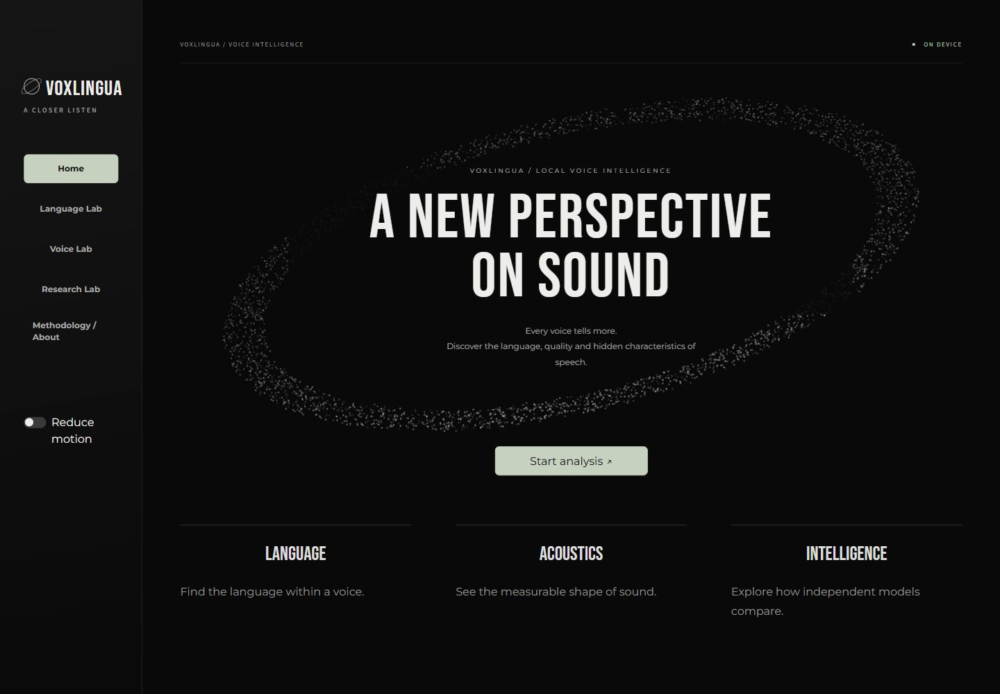

# VoxLingua
### Multilingual Speech Analysis and Audio Distortion Classification Using Ensemble Learning

## Introduction

VoxLingua is a local speech analysis application that helps users explore the language and sound characteristics of a recording. Users can upload a WAV file or record speech through their browser, then inspect language predictions, recording conditions, acoustic measurements, and audio visualizations.

The project combines pretrained language recognition, ensemble learning, and signal processing through three independent analysis paths. A shared recording session connects Language Lab and Voice Lab, bringing together language rankings, waveform playback, spectrograms, and voiced pitch. Audio processing and model inference run locally.

## Live Audio Capture

The browser requests microphone permission when the user starts recording. A Web Audio API AudioWorklet captures the microphone input, while the interface shows the selected device, an input-level meter, and elapsed time. Recordings can run for up to 15 seconds.

After capture stops, the application encodes the audio as a mono PCM16 WAV for playback and analysis. Empty or nearly flat captures receive a signal warning. An accepted recording follows the same three analysis paths as an uploaded WAV and remains available across both labs in the current session.

## Three Independent Analysis Paths

~~~mermaid
flowchart LR
    A[WAV upload or microphone capture] --> B[Decode and validate]
    B --> C[Language identification]
    B --> D[Recording-condition classification]
    B --> E[Acoustic signal analysis]
    C --> C1[Pretrained language models]
    D --> D1[84 acoustic features]
    D1 --> D2[Four classifiers and grouped stacking]
    E --> E1[Measurements and visualizations]
    C1 --> F[Shared lab views]
    D2 --> F
    E1 --> F
~~~

### Language Identification

A mono, 16 kHz audio copy is processed by the primary language model to produce ranked language scores. A gated Whisper second opinion supports selected Hindi and Tamil decisions. Language Lab displays the selected language, original rankings, and an illustrative language-region globe.

### Recording-Condition Classification

The shared extractor converts audio into 84 acoustic features. Four classifiers and grouped stacking identify one of six recording conditions, reference, added noise, clipping, low volume, frequency filtering, or interruption.

### Acoustic Signal Analysis

Signal processing measures recording levels, clipping indicators, estimated SNR, speech activity, silence, spectral characteristics, and voiced pitch. Voice Lab presents these values alongside a waveform and a time-frequency spectrogram.

## Models and Their Roles

### Vaani-LID (Primary Language Identification)

The pretrained ARTPARK-IISc model combines a Whisper-based encoder, attention pooling, and a classification layer to rank supported languages from the speech input.

### Whisper Large-v3-turbo (Language Second Opinion)

The pretrained OpenAI model supplies language-token scores for selected Hindi and Tamil cases. A gated rule checks agreement with a candidate in the primary ranking.

### CART (Single Decision Tree)

CART learns feature thresholds that separate recording conditions. It provides an interpretable tree prediction and contributes class scores to the ensemble.

### Random Forest (Bagging)

Random Forest combines trees trained on resampled examples and randomized feature subsets. It captures varied acoustic relationships and contributes averaged class scores.

### AdaBoost (Sequential Boosting)

AdaBoost trains small trees in sequence, increasing emphasis on previously misclassified examples. Their weighted combination contributes another recording-condition prediction.

### XGBoost (Gradient Boosting)

XGBoost adds regularized trees to improve a multiclass objective. It learns nonlinear interactions among acoustic features and supplies class scores to the ensemble.

### Soft Voting (Equal-Weight Combination)

Soft voting averages the six-class scores from the four classifiers with equal weights and selects the class with the highest combined score.

### Logistic Regression (Grouped Stacking)

The stacking combiner learns from 24 scores supplied by the four classifiers. Grouped out-of-fold predictions train the combiner, which supplies the application's selected recording-condition prediction.

### Threshold Baseline (Signal Rules)

Stored rules examine recording levels, clipping, gaps, and spectral cutoff. A fixed precedence resolves multiple triggers to produce a transparent condition prediction.

### pYIN (Voiced Pitch Estimation)

Probabilistic YIN estimates fundamental frequency in voiced frames. VoxLingua reports their median pitch in hertz as part of acoustic analysis.

## Acoustic Features

Training and inference use the same 84 ordered features and preserve recording amplitude.

| Feature family | Captures |
| --- | --- |
| Amplitude and clipping | Signal level, peak structure, and flattened samples |
| Frame-level dynamics | Short-term level changes |
| Spectral summaries | Frequency-energy location, spread, flatness, and zero crossings |
| MFCC summaries | Speech spectral-envelope statistics |
| Band energy and shape | Energy distribution across frequency bands |
| Gaps and noise-floor cues | Interruptions, abrupt changes, and low-energy characteristics |

## Dataset Sources and Preparation

Google FLEURS supplies English, Hindi, Tamil, Bengali, and Telugu speech. MUSAN provides production environmental noise, while ESC-10 supplied noise for the development pilot.

Preparation verifies source hashes, validates audio, screens reference recordings, and assigns splits before generating controlled transformations. Each original and its variants remain together, while noise sources are separated across partitions. The shared extractor produces classifier features from the prepared recordings.

| Dataset | Project use | License |
| --- | --- | --- |
| [Google FLEURS](https://huggingface.co/datasets/google/fleurs) | Multilingual speech | CC BY 4.0 |
| [MUSAN](https://www.openslr.org/17/) | Production environmental noise | CC BY 4.0 |
| [ESC-10](https://github.com/karolpiczak/ESC-50) | Development-pilot noise | CC BY 3.0 |

## Tech Stack

| Area | Technologies |
| --- | --- |
| Programming | Python |
| Interface | Streamlit, HTML, CSS, JavaScript |
| Visualization | Plotly, Canvas API |
| Microphone capture | Web Audio API, AudioWorklet |
| Audio processing | NumPy, SciPy, librosa, SoundFile |
| Machine learning | scikit-learn, XGBoost |
| Language inference | PyTorch, Transformers |
| Model storage | Joblib, Safetensors |
| Configuration | YAML, JSON |
| Testing | pytest, Streamlit AppTest |

## Model Attribution

The pretrained language components are [ARTPARK-IISc Vaani-LID](https://huggingface.co/ARTPARK-IISc/Vaani-LID_v0) and [OpenAI Whisper large-v3-turbo](https://huggingface.co/openai/whisper-large-v3-turbo), both distributed under MIT licenses. VoxLingua integrates them with its trained recording-condition classifiers, ensemble methods, and acoustic analysis services.
